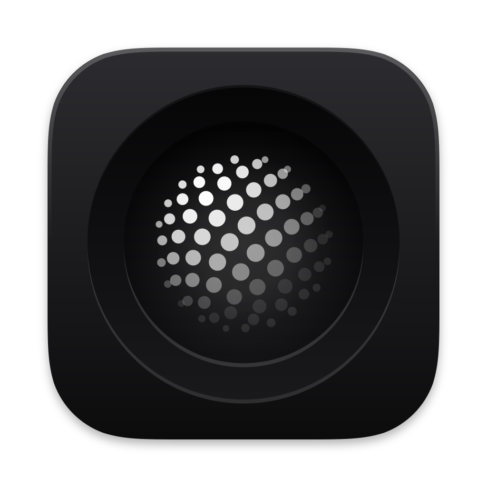

<p align="center">
  
</p>

<h1 align="center">Cloudstash</h1>

<p align="center">
  Cloudstash saves links into a private library and makes them easy to find
  again. It is for people who collect more links than they can read at once.
</p>

## What it does

You save a URL from the web app, the Chrome extension, Telegram, Raycast, the
public API, an MCP client, or your X bookmarks. The link shows up at once.
Cloudstash then fetches the page's title, description and image, writes a short
summary, and suggests tags. Links move between Inbox, Completed, All and
Archive, and search runs locally over titles, tags, domains, descriptions,
summaries and URLs. The library syncs across devices.

Some capture surfaces and the chat agent need a paid plan; see
[`context/01-product/spec.md`](context/01-product/spec.md).

## Parts

- **Web app and server** (`src/`): React on Cloudflare Workers, with D1,
  Durable Objects and LiveStore for sync. Infrastructure is declared in
  [`alchemy.run.ts`](alchemy.run.ts).
- **Mac app** ([`apps/native`](apps/native)): a native client written in Rust,
  released through GitHub Releases.
- **Chrome extension** ([`apps/extension`](apps/extension)): saves the current
  tab. Published on the
  [Chrome Web Store](https://chromewebstore.google.com/detail/cloudstash/bdommhffamndfanbpnikgmpjncpcobia).
- **Integrations** (`src/cf-worker/`): Telegram bot, X bookmark sync, MCP
  server, public API. The Raycast extension is released separately.

## Run it locally

You need [Bun](https://bun.sh) and a `.env` file with `BETTER_AUTH_SECRET`,
`GOOGLE_CLIENT_ID` and `GOOGLE_CLIENT_SECRET`; `.env.example` lists every
variable. Maintainers fill `.env` from 1Password with `bun run env:sync`.

```sh
bun install
bun run dev
```

`bun run dev` takes the first free port from 3000 and prints the address. Sign
in with Continue with Google: locally this goes to a Google stand-in where you
pick a test account. The other variables are optional and turn on AI
chat, email, Telegram, X and billing.

To run the Mac app against that server, run `scripts/run.sh` in
`apps/native` (macOS, Rust toolchain).

```sh
bun run test        # all tests
bun run check       # format, lint, types, Intent and migration checks
```

## Documentation

How Cloudstash works and why lives in [`context/`](context/). Start with
[`context/intuition.md`](context/intuition.md). Rules for contributors and
coding agents are in [`AGENTS.md`](AGENTS.md).

## Licence

[PolyForm Noncommercial 1.0.0](LICENSE). You may use, change and self-host
Cloudstash for non-commercial purposes. Commercial use needs a separate
licence.
